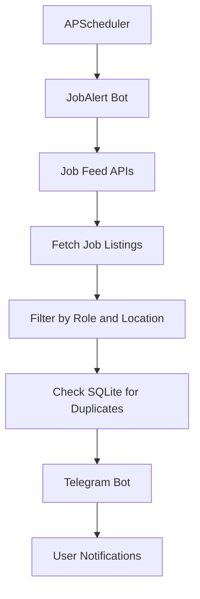

# JobAlert – Telegram Job Notification Bot

A Python-based Telegram bot that automatically collects job and internship opportunities and sends notifications directly to Telegram.

## About the Project

JobAlert helps job seekers discover opportunities without manually checking multiple websites every day. It collects job listings from public job feeds, filters them according to selected roles, and sends notifications through Telegram.

## Features

- Automated job and internship notifications.
- Scheduled updates twice daily – 9:00 AM and 6:00 PM IST.
- Role-based job filtering.
- India and remote opportunity preferences.
- Duplicate job detection using SQLite.
- Telegram bot commands.
- Easy configuration using environment variables.

## Technologies Used

| Technology | Purpose |
|---|---|
| Python | Core programming |
| Telegram Bot API | Sending notifications |
| SQLite | Storing previously sent jobs |
| Requests | Fetching job listings |
| APScheduler | Scheduling notifications |
| python-dotenv | Managing environment variables |

## Job Categories

- Java Developer
- Python Developer
- Frontend Developer
- Software Developer
- Internships
- Data Analyst
- Web Developer

## Project Architecture



## Project Structure

```text
JobAlert-Telegram-Bot/
│
├── main.py
├── requirements.txt
├── README.md
├── .env.example
├── .gitignore
└── .venv/
```

Note: `.venv/` and `.env` are local files and should not be uploaded to GitHub.

## Installation and Setup

### 1. Clone the repository

```bash
git clone https://github.com/Nageswari2005/JobAlert-Telegram-Bot.git
```

### 2. Open the project folder

```bash
cd JobAlert-Telegram-Bot
```

### 3. Create a virtual environment

```bash
python -m venv .venv
```

### 4. Activate the environment

Windows PowerShell:

```powershell
.venv\Scripts\Activate.ps1
```

### 5. Install dependencies

```bash
pip install -r requirements.txt
```

### 6. Configure your Telegram bot token

Create a `.env` file in the project folder:

```env
TELEGRAM_BOT_TOKEN=your_telegram_bot_token
```

Replace the placeholder with your own token. Never upload your `.env` file or share your bot token.

### 7. Run the bot

```bash
python -m main
```

Open your bot in Telegram and send:

- `/start` – Start the bot.
- `/jobs` – Request job listings.
- `/help` – View available commands.

## Job Sources

The starter version uses public job feeds such as:

- Remotive API
- Remote OK public feed

These sources are primarily remote-focused. India-specific coverage and country eligibility should be verified for individual listings.

## Future Improvements

- Add more India-focused job sources.
- Add company-wise job filtering.
- Add internship-specific filters.
- Deploy the bot to a cloud server for 24/7 operation.
- Add more user preferences and notification settings.

## Author

**Nageswari**

Computer Science and Engineering Student

GitHub: [Nageswari2005](https://github.com/Nageswari2005)

---

If you find this project useful, feel free to explore the repository and share your feedback!